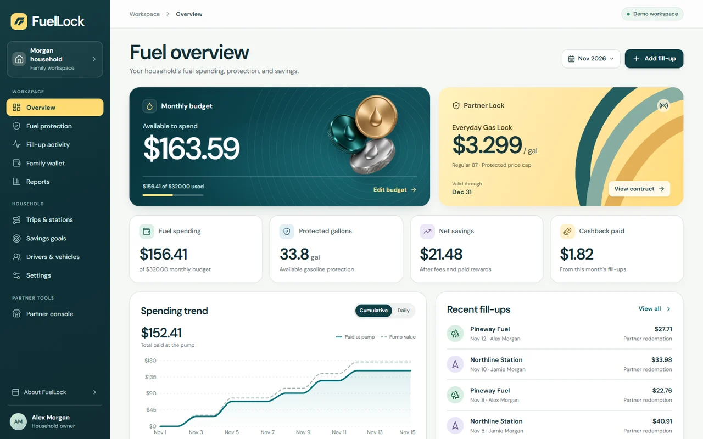

# FuelLock

FuelLock is a web application for a two-driver household sharing a fuel budget. A driver sees a partner agreement, its redemption code and remaining gallons. A simulated station operator previews the price split and records the fill-up. Both drivers see the resulting balance, cashback and financial result.



## Run locally

Use Node.js 22.12 or newer and npm. From the repository root run:

```sh
npm ci
npm run db:migrate
npm run db:seed
npm run dev
```

Open [the landing page](http://localhost:3000) and select **Try demo** to create a private, seeded household for that browser. The dashboard is at `/overview`. Opening a workspace page without a valid session takes you to `/login` and returns you to the requested page after demo sign-in. A second browser joins the same household through a one-time driver invitation. No API keys are needed for the core product.

For a production build:

```sh
npm run build
npm start
```

The default database is `file:data/fuellock.db`. For an existing Turso database, set the server environment variables from `.env.example`, apply the migrations, and start the Next.js Node server. The file-backed configuration requires a persistent writable disk. Keep credentials out of client code and source control.

## Five-minute demo

1. In **Overview**, select **View contract**. Note the cap, allowed stations, shared balance and redemption code.
2. In **Drivers & vehicles**, create an invitation. Open it in another browser profile and accept as the second driver. Leave that overview open.
3. In **Partner console**, enter the existing gasoline contract code. Select Pineway Fuel, Gasoline and Regular 87, enter **40** gallons and a **4.199** pump price. Preview the split, then confirm. A fresh demo covers 33.8 gallons and bills 6.2 at the pump price. The second driver sees the update.
4. Open the new purchase in **Fill-up activity**. Attach a receipt, then cancel the purchase. The shared gallons return and its reward and savings entries reverse.
5. Open **Fuel protection → Offer catalog**, request a diesel lock or prepaid gallons, then activate the request in **Partner console**. The agreement now has a usable code. A Pre-buy redemption draws on the prepaid gallons first.
6. For a receipt claim, add a new self-paid Regular 87 fill-up at Pineway Fuel for **12.125** gallons at **4.249** and attach a PNG, JPEG or PDF. Submit it under **Fuel protection → Receipt protection**. Approve and then pay it in **Partner console**. The simulated reimbursement is **$4.80**.
7. Compare **Trips & stations** for the commute and the school run. Change a **Savings goals** rule, inspect **Family wallet**, and try a different pump price in **Reports**.

## Product and business model

The Family plan costs $6.99 per month, with $0 charged during the demo. The hypothesis is a $4.00 contribution per family at a $2.99 monthly variable cost limit. Partner offers disclose their protection fee and service fee before acceptance. Those fees are earned on activation in the simulation. Pre-buy has a separate upfront purchase price for physical gallons at the named merchant. Cashback is a simulated partner-funded 2% of the fuel amount paid at the pump.

| Screen | Working actions |
| --- | --- |
| Overview | Select a budget period, edit the limit, open a contract, record a fill-up, inspect daily or cumulative spending |
| Fuel protection | Review versioned terms, request an offer, inspect remaining gallons and codes, withdraw a pending request, close an agreement, submit a receipt claim |
| Partner console | Activate, preview, redeem, approve or reject a claim and mark its reimbursement paid |
| Fill-up activity | Filter by driver or status, import a manually entered bank record, upload or download evidence and reverse a purchase |
| Family wallet | Reconcile fuel, prepaid purchases, protection and service fees, financial benefit, rewards and paid claims |
| Trips & stations | Rank eligible stations by estimated pump payment plus the cost of the round-trip detour for the selected vehicle |
| Savings goals | Create targets, allocate future round-ups, direct newly paid cashback to a goal |
| Drivers & vehicles / Settings | Invite a second driver, add vehicles, edit names and the default monthly budget, inspect the pilot tariff |
| Reports | Review computed monthly results, change hypothetical gallons and prices, optionally generate AI-selected highlights |

## Money and accounting

All posted amounts are integer cents. Prices are integer microdollars per US gallon and volume is integer milligallons. Decimal strings are parsed directly into integers. Products use BigInt and each final monetary line is rounded half up to cents. Formatting uses en-US conventions.

For a Partner Lock, let `q = min(purchased volume, available eligible volume)`. The fuel line is `q × min(pump price, cap) + uncovered volume × pump price`. The protection benefit is `q × max(0, pump price − cap)`. Each line is calculated before rounding. Fees have separate lines.

Pre-buy charges the prepaid quantity once at partner activation. Only gallons above the remaining balance incur a pump payment. The realized price difference on consumed prepaid gallons may be negative.

- **Budget spending** includes pump payments, prepayments and agreement fees for the period.
- **Net financial result** includes the lock benefit, realized pre-buy difference, paid cashback and paid claims, less protection and service fees.
- **Wallet balance** includes all-time paid cashback available to the wallet plus paid claims. Cashback allocated to a goal stays in that goal.
- **Round-ups** are simulated savings contributions. They do not increase fuel expense or protection benefit.
- Reports assign realized rewards and claims to their purchase month. Fees and prepaid purchases belong to their activation month. Reversals remove the original purchase from posted totals.

## Transaction and evidence model

`src/server/domain/purchases.ts` validates the driver, station, fuel, grade, agreement term and status. A single libSQL write transaction checks the previewed protected quantity, conditionally moves gallons from available to reserved, records or reconciles one purchase, moves the reservation to used, and records the request key. A database trigger enforces the total agreement volume. Accepted pricing and eligibility terms are immutable.

A retry with the same key and payload returns the original purchase ID. A conflicting reuse of a key fails. A stale preview requires a fresh confirmation. Cancellation is idempotent and reverses the effects of the original fill-up. SSE broadcasts committed changes to other connected household members. Focus refresh and a 30-second refresh cover reconnections and multiple server instances.

`src/server/domain/receipts.ts` deduplicates file bytes by SHA-256. The purchase fingerprint uses household scope, driver, station, UTC purchase minute, fuel and grade, exact volume and exact pump price. Another source with these fields links to the same purchase. A driver can also attach a receipt directly to an existing fill-up. Files are limited to 3 MB and served through a session-checked attachment route.

Receipt protection is a separate pay-first program with actual-receipt terms. A posted, unprotected purchase needs eligible evidence. The server computes the claim amount. The partner simulator advances it from pending to confirmed to paid, or rejects it. A cancellation reverses a related claim. The offer acceptance deadline and active agreement dates have distinct checks.

## Architecture

One Next.js App Router application serves the English interface and API. React, Tailwind CSS, Radix Dialog and Recharts provide the UI. Drizzle reads typed household snapshots. The same libSQL driver executes explicit write transactions against local SQLite or Turso. Zod validates action and upload inputs. Vitest runs unit and integration tests.

- `src/app` — pages, session entry and invitation routes, mutation endpoints, receipts and update stream
- `src/components` — desktop and responsive workspace, partner console, forms, charts and landing-page components
- `src/server/domain` — integer money, redemption, receipts, claims, reporting, planning and savings rules
- `src/server/providers` — simulated partner terms, route inputs, demo fixtures and optional model adapter
- `src/server/db` and `migrations` — typed schema, connections, ordered transactional SQL migrations
- `tests` and `scripts/smoke.mjs` — domain and database coverage plus a two-browser, two-viewport product walkthrough

## Verification

| Command | Purpose |
| --- | --- |
| `npm run dev` | Development server |
| `npm run build` / `npm start` | Production build and server |
| `npm run typecheck` / `npm run lint` | TypeScript and ESLint |
| `npm test` | Integer rounding, transactions, races, idempotency, rollback, evidence, offers, pre-buy, rewards, claims, permissions and demo reset |
| `npm run db:migrate` | Apply pending versioned migrations |
| `npm run db:seed` | Create the canonical sample household if missing |
| `npm run db:reset` | Restore demo-marked households and preserve active browser sessions by driver role. Households with `demo=0` are retained |
| `npm run test:e2e` | Run the 1440 px and 390 px walkthrough against an already running server |
| `npm run test:routes` | Check session cookies and redirect counts on a running server using the same `FUELLOCK_TEST_URL` |

For the browser walkthrough, set `FUELLOCK_TEST_URL` to the running origin. The script defaults to `http://127.0.0.1:3040`. Set `BROWSER_EXECUTABLE` if Chromium, Chrome or Edge is installed outside the detected paths. Set `FUELLOCK_SCREENSHOTS` to an output directory to save both overview screenshots. Each run creates independent demo households. The second driver uses a separate browser context.

## Assumptions

- The supplied product brief ends at the section 7 heading. This implementation follows the available sections and their phased feature list.
- New browser profiles receive isolated demo data for a two-driver US household. The owner can enter simulated partner mode. The invited driver has a scoped session. Browser sessions expire after 30 days and a one-time invite expires after 24 hours.
- Shared fuel contracts and receipts are visible within the household. Owner-only offers restrict redemption to the owner. Operator actions, household settings and payout transitions also require the owner role in this demo.
- The budget calendar uses UTC months. Purchase entry accepts the driver's local date and time and stores UTC. Contract dates and transaction detail timestamps explicitly use UTC.
- Each agreement has one redemption balance and one fuel grade. A station transaction uses one agreement. Closing it keeps previously posted fees or prepayments. Expiration is derived from the agreement end date when reading and checked again when redeeming.
- The station catalog, prices, corridors and detour distances are simulated inputs. Recommendations recompute from the selected vehicle, volume, eligibility and current household balances. The ranking optimizes estimated cash due now and detour fuel. An earlier prepayment is already reflected in the budget.
- Bank records are entered manually and the simulated partner reviews receipt evidence. The matching rule treats identical purchases within a minute as one event. All financial entries are simulated.
- The landing photograph and financial statement artwork are served locally as WebP files. The built-in ImageGen tool produced the trimmed transparent asset at `public/images/fuel-tokens.webp` from a brief for three overlapping, ribbed-edge fuel tokens in champagne gold, teal and brushed silver, embossed with a fuel droplet. The contract pass uses CSS so its price and expiration stay readable and update with the agreement.

## Optional AI reports

With an existing Ollama server, set `OLLAMA_URL` and `OLLAMA_MODEL` on the server. Optional `OLLAMA_TOKEN` supports an authenticated gateway. Restart the application to enable **Generate AI highlights** in Reports. Only aggregate, precomputed facts are sent. The model ranks their IDs through a structured response. FuelLock validates those IDs and renders the exact financial statements. The model cannot change prices, balances or claims.

The ordinary monthly report, chart and scenario calculator work offline. The optional adapter has protocol tests for allowed and invented facts. Live inference and a hosted Turso connection require existing services and were not part of the local verification.

## Roadmap

Production partners would need independent operator identities, a merchant receipt reference shared across bank and station feeds, attested station pricing, and audited settlement integrations. The current pilot uses one simulated tariff and curated routes. Live maps, OCR, bank connections, account recovery and paid subscription billing are future integrations.
